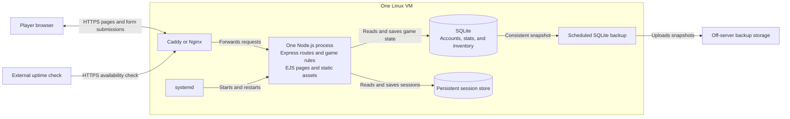

# Drevan launch architecture

This is an optional reference for a small alpha or public launch. It shows a proposed setup on a single Linux virtual machine (VM). The production session store, proxy, backups, and monitoring shown here would need to be set up before launch. The current Express app uses the default in-memory session store, so restarting the process clears logins and pending reports. Player progress and expedition position are stored in SQLite.

## How it runs

- **Starting size.** One shared vCPU, 2 GiB of RAM, and 50 GiB of storage is a planning estimate. Test a burst of signups and training on the chosen VM before opening registration.
- **Gameplay.** Express validates each action and applies the game rules. Training and Ruins combat share the simulator. Each mode saves HP and rewards in its own transaction and redirects to an EJS page that shows the result. Fishing saves each cast and catch together. Practice duels are planned.
- **Deployment.** Use the Node version pinned in `.nvmrc`. Run `yarn build` and deploy `dist/`, `src/views/`, and `public/` with the runtime dependencies. The app opens `./data/game.sqlite` relative to its working directory. Provide a persistent `data/` directory and set `SESSION_SECRET` for the app. Run `yarn db:migrate` with `DATABASE_URL` pointing to the same file, then run `yarn db:seed` from that working directory for initial setup or catalog updates. These maintenance commands require the migration files, TypeScript sources, and development dependencies. Start the app with `yarn start` or `node dist/app.js`.
- **Recovery.** Take a consistent snapshot using SQLite's backup API, keep copies off the VM, and test restoring one. The uptime check detects an outage. A VM failure can still take the game offline until the service or server is restored.

## When to revisit

Measure slow requests and database errors under realistic load. If short game updates routinely wait for other writes, or the game needs multiple app servers sharing player state, revisit managed PostgreSQL and a shared session store.
