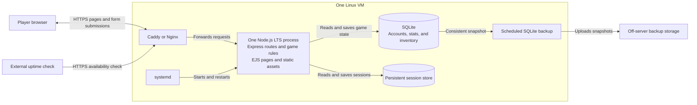

# Drevan launch architecture

This is an optional reference for a small alpha or public launch. It shows a proposed setup on a single Linux virtual machine (VM). The production session store, proxy, backups, and monitoring shown here would need to be set up before launch.

## How it runs

- **Starting size.** A DigitalOcean Basic Droplet with 1 shared vCPU, 2 GiB of RAM, and a 50 GiB SSD is a starting estimate. Test a burst of signups and training on the chosen VM before opening registration.
- **Gameplay.** Express validates each action and applies the game rules. A training request resolves the fight and saves HP and rewards. EJS renders the result as HTML. Gear bonuses, fishing, and practice duels fit this same request flow.
- **Deployment.** Build the TypeScript and Sass, deploy the compiled app with its EJS templates and public assets, and run migrations against the live database path. Keep the SQLite file and session data outside the release directory so they survive deploys.
- **Recovery.** Take a consistent snapshot using SQLite's backup API, keep copies off the VM, and test restoring one. The uptime check detects an outage. A VM failure can still take the game offline until the service or server is restored.

## When to revisit

Measure slow requests and database errors under realistic load. If short game updates routinely wait for other writes, or the game needs multiple app servers sharing player state, revisit managed PostgreSQL and a shared session store.
