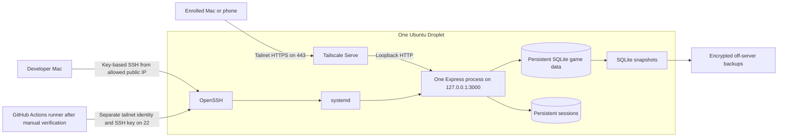

# Drevan launch architecture

Start the personal and invited alpha on one DigitalOcean Droplet. Use Tailscale Serve for private, browser-trusted HTTPS under a Tailscale-provided `.ts.net` hostname. Defer domain selection, branding, registration, and public DNS until a public launch is planned. Follow the [deployment guide](../development/deployment.md) in order and record the evidence required by the [alpha gates](roadmap.md#alpha-deployment-gates).

## Alpha access options

All options share the Droplet cost. Start with Ubuntu 24.04 LTS on a shared-CPU Basic plan with about 2 GiB RAM and check the available plan and monthly price in the chosen region. Measure a burst of signups and training before inviting external testers. Managed backups and monitoring services are optional purchases. The walkthrough uses SQLite snapshots and an encrypted off-server copy. Standard hosted GitHub Actions runners are free for public repositories. Private repositories draw against the account’s included usage and can incur charges above it. [DigitalOcean Droplet pricing](https://www.digitalocean.com/pricing/droplets) · [GitHub Actions billing](https://docs.github.com/en/actions/concepts/billing-and-usage)

### Direct public IP over HTTP

- **Setup and certificates.** A public IPv4 or IPv6 and a reverse proxy on port 80 suffice. Setup is simple and requires no certificate or domain. Keep Node on loopback.
- **Security and mobile.** Ordinary phone browsers can reach a compatible public address, but traffic is readable and alterable in transit. An unlisted URL grants no privacy. Use public HTTP only for a future CA challenge or a redirect, with no login, credentials, or authenticated session cookies sent over it.
- **Cost, CI, and fit.** No additional service fee for HTTP. GitHub Actions can deploy over independent SSH. A publicly reachable HTTP-only game is unsuitable even for personal remote login. Replace this endpoint with private HTTPS, IP HTTPS, or domain HTTPS before authenticating.

### Public IP with browser-trusted HTTPS

- **Setup and certificates.** Use a stable public IP, Nginx, and a compatible ACME client such as Certbot 5.4 or later with webroot validation. Let’s Encrypt requires its `shortlived` profile for IP certificates, currently valid for 160 hours. Allow inbound port 80 for the ACME HTTP challenge and serve the app only over 443. Configure Nginx to load the IP certificate and key, schedule automatic renewal, reload Nginx via a successful-renewal hook, and monitor expiry. The documented Certbot webroot procedure obtains the certificate and leaves installation to the operator. Caddy's documented default for IPs uses its local CA, so the conventional domain Caddyfile is insufficient for public browser trust at an IP. [Let’s Encrypt IP certificates](https://letsencrypt.org/2026/01/15/6day-and-ip-general-availability.html) · [Certbot IP setup](https://letsencrypt.org/2026/03/11/shorter-certs-certbot) · [Caddy automatic HTTPS](https://caddyserver.com/docs/automatic-https)
- **Security and mobile.** Browsers can validate `https://IP` when the IP matches the certificate and the phone can route to that address. An IPv6 literal uses brackets in a URL. TLS protects transport. A separate login or access gate must control who can reach an invited alpha because the proxy is reachable by the public.
- **Cost, CI, and fit.** Let’s Encrypt certificates and the proxy software are free. Check any cost of retaining a stable address. SSH deploys work independently of the web endpoint. Suitable when testers cannot enroll devices and you can operate the access gate and short renewal cycle. To go public under a name, add DNS and issue a certificate for the new hostname. Expect a fresh browser login on the new host.

### Tailscale Serve over a private network — recommended

- **Setup and certificates.** Install Tailscale on the Droplet and each tester device, enable MagicDNS and HTTPS certificates, and grant testers access to the Droplet on TCP 443. Serve terminates HTTPS and proxies to loopback. It provisions and renews the public certificate for the assigned hostname. Certificate transparency lists that hostname publicly, so choose neutral machine and tailnet names. Network policy controls reachability even when someone knows the URL. [Tailscale Serve](https://tailscale.com/docs/features/tailscale-serve) · [Tailscale HTTPS](https://tailscale.com/docs/how-to/set-up-https-certificates)
- **Security and mobile.** Approve devices, restrict the alpha grant to the intended tester identities, and require Drevan login on top of network access. Testers use the Tailscale app on iOS or Android and their regular browser. A connected VPN is an extra step, and an existing VPN profile may conflict. Removing an invitation alone does not evict an existing member. Remove the grant or member and revoke lost devices. [Device installation](https://tailscale.com/docs/install) · [Grants](https://tailscale.com/docs/features/access-control/grants) · [User invitations](https://tailscale.com/docs/features/sharing/how-to/invite-any-user)
- **Cost, CI, and fit.** Tailscale Personal currently permits six free users in a tailnet for eligible personal use. Confirm plan eligibility and capacity before expanding. The developer administers via key-based SSH restricted to an approved public source. A later hosted GitHub Actions runner can join with its own ephemeral tag and reach SSH on 22 alone. It uses a separate deployment key and can check app health through the server-side deploy command. Players only reach 443. This fits personal and small invited testing with no paid proxy, certificate, or registrar required. Later, add public DNS and a proxy against the same app and data. Remove private play access when you are ready to retire it. [Tailscale free plans](https://tailscale.com/docs/account/manage-plans/free-plans-discounts) · [Tailscale GitHub Action](https://tailscale.com/docs/integrations/github/github-action)

### Conventional domain-based HTTPS — future configuration

- **Setup and certificates.** Register a domain, publish DNS address records, and run Caddy with the chosen hostname and public ports 80 and 443. It can provision and renew a publicly trusted certificate automatically when public DNS and ACME validation reach the proxy. The [optional walkthrough](../development/deployment.md#optional-connecting-a-domain-name-later) explains the cutover. [Caddy automatic HTTPS](https://caddyserver.com/docs/automatic-https)
- **Security and mobile.** Works in ordinary desktop and phone browsers without VPN enrollment. A public proxy invites internet traffic, so decide whether registration is public or protected by a separate access gate. TLS secures the connection and verifies the hostname.
- **Cost, CI, and fit.** Budget for recurring registrar fees. Caddy and public ACME certificates require no paid subscription. Keep deployment SSH independent of the web hostname. This is the natural public configuration, with little benefit for a handful of enrolled testers. Keep the same releases and database and have users sign in again at the new origin.

## Application readiness and operations

- **Listener and cookies.** The current process calls `app.listen(port)` without an explicit address and uses the default Express session store and cookie configuration. Before rolling out the guide, support a verified loopback bind, a persistent session store with expiry and restart survival, and secure cookies behind the trusted local proxy. Verify the proxy supplies the HTTPS scheme and overwrites client-supplied forwarding information before Express uses it. Establish the exact runtime settings and sync them with the walkthrough. [Current app wiring](../../src/app.ts) · [Express proxy configuration](https://expressjs.com/en/guide/behind-proxies.html)
- **Authorization.** Restrict the self-editing Admin portal on the server to an explicit development or authorized boundary. A signed-in alpha player with this access can still edit their own progression, which makes competitive records, rankings, and trading untrustworthy. Verify the route and mutation boundary as an ordinary account. [Application architecture](../development/architecture.md)
- **Persistence.** The current app and seed open `./data/game.sqlite` relative to their working directory. The walkthrough links each release's `data/` to one shared directory and points Drizzle migrations at that same file via `DATABASE_URL`. A release holds the exact commit, pinned dependencies, build, templates, static assets, and migrations. A separate path holds secrets. Back up consistent SQLite snapshots off-server and rehearse recovery before inviting external testers. [Database development](../development/database.md)
- **Service and monitoring.** Run under a dedicated system account. systemd starts the app at boot and restarts it on failure. Monitor service status, HTTP availability, disk space, backup freshness, and certificate validity. A public uptime monitor cannot probe a private Serve endpoint. Use a permitted tailnet device for an end-to-end check and the Droplet for the loopback check. Observe logs and set an alert path before external testing.
- **Capacity.** One machine keeps operations simple and remains a single point of failure. Track response time, memory, disk space, and SQLite lock errors under realistic use. Revisit managed PostgreSQL and a shared session store if write contention becomes frequent or more app servers need to share state.
